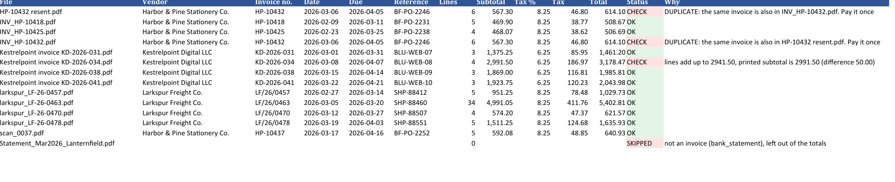

# AI Invoice Extractor

A folder of PDF invoices in, one checked Excel workbook out.

Claude reads every PDF (typed or scanned), plain code checks the arithmetic, and anything that does not add up is flagged for a person instead of being quietly "fixed".



## Measured on the sample set

14 synthetic documents in `sample_invoices/`: 13 invoices from 3 fictional vendors (one is a scan) and 1 bank statement mixed in by mistake. Every field was compared with the value printed on the page (`tests/answer_key.json`, used only for scoring).

| | Fields right | Accuracy |
|---|---|---|
| Model's first reading | 552 of 553 | 99.82% |
| After the arithmetic check and one second look | 553 of 553 | 100% |

What the checks caught:

| Document | What happened |
|---|---|
| `Kestrelpoint invoice KD-2026-034.pdf` | First reading had a subtotal of 2,941.50. The check saw the lines did not match, the model took a second look and read 2,991.50, which is what is printed. The lines on that invoice really do add up to 50.00 less than the printed subtotal, so it stays **CHECK** for a person. |
| `INV_HP-10432.pdf` + `HP-10432 resent.pdf` | Same vendor, same invoice number: both marked **DUPLICATE**, pay once. |
| `Statement_Mar2026_Lanternfield.pdf` | A bank statement, not an invoice: **SKIPPED** and left out of the totals. |

Run the scores yourself:

```bash
python score_accuracy.py --first-pass   # 552 of 553
python score_accuracy.py                # 553 of 553
```

## How it works

1. **Read.** Each PDF goes to Claude as a document. The answer comes back as a typed object (structured output, validated with Pydantic): vendor, invoice number, dates, PO reference, every line, subtotal, tax, total.
2. **Check.** Plain Python, no AI: each line is qty x unit price, the lines add up to the subtotal, subtotal + tax = total. Money is handled with `Decimal`, never floats.
3. **Second look.** If a check fails, the model gets one more look with the exact errors. If the page itself is wrong, the printed numbers are kept and the invoice is flagged.
4. **Flag.** Duplicates (same vendor + invoice number) and documents that are not invoices are marked.
5. **Write.** `output/invoices.xlsx` with three sheets: Invoices (status and reason per file), Line items, Checks.

## Run it

```bash
pip install -r requirements.txt

# No API key needed: replays the saved model responses in recorded/
python extractor.py sample_invoices --replay

# Live, on your own PDFs (copy .env.example to .env and add your key)
python extractor.py path/to/your/invoices
python extractor.py path/to/your/invoices --record   # also saves the responses to recorded/

python -m pytest -q tests                            # 14 tests, no key needed
```

The model is `claude-opus-5-5` by default; set `EXTRACTOR_MODEL` to use another Claude model.

## Notes

- The saved responses in `recorded/` were produced by Claude Opus 5.5 reading each PDF with the same prompt and schema as `extractor.py` (each file says how it was recorded). `--replay` exists so anyone can check the pipeline and the scores without a key.
- All vendors, people and numbers in the sample documents are made up.
- Your key stays in your `.env`, which git ignores. Nothing is sent anywhere except the Anthropic API.

## Files

```
extractor.py          read -> check -> second look -> Excel
score_accuracy.py     compares results with the answer key
sample_invoices/      14 sample PDFs
recorded/             saved model responses (for --replay)
tests/                unit tests + answer key
output/               invoices.xlsx, accuracy.json
```

MIT licence.
